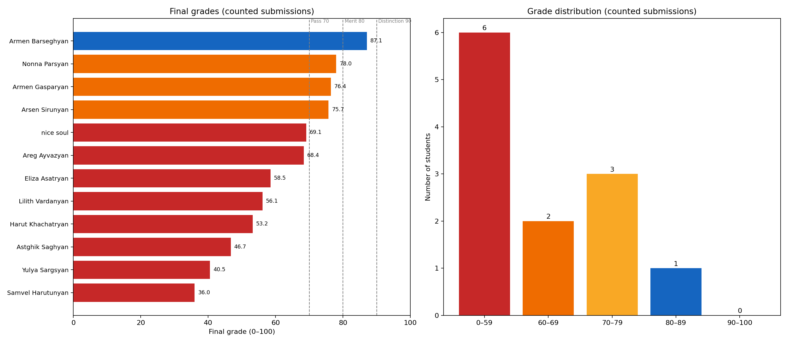

# ML Engineer Certification — Final Gradebook

**Exam:** ML Engineer Certification (Versions A–D)  
**Graded:** 2026-11-01  
**Scale:** Raw 151 marks → Final grade 0–100 (`raw / 151 × 100`). Pass ≥ 70; Merit 80–89.9; Distinction ≥ 90.

## Grade distribution (counted submissions)

| Band | Students | Share |
|---|---:|---:|
| 0–59 | 6 | 50.0% |
| 60–69 | 2 | 16.7% |
| 70–79 | 3 | 25.0% |
| 80–89 | 1 | 8.3% |
| 90–100 | 0 | 0.0% |

- **Counted submissions:** 12
- **Mean:** 62.1
- **Median:** 63.5
- **Population standard deviation:** 15.5
- **Minimum / maximum:** 36.0 / 87.1
- **Pass rate:** 33.3%
- **Merit rate:** 8.3%
- **Distinction rate:** 0.0%

## Gradebook

| Rank | Student | Version | A /50 | B /20 | C /30 | D /16 | E /35 | Raw /151 | Final /100 | Result | Counted |
|---:|---|---:|---:|---:|---:|---:|---:|---:|---:|---|---|
| 1 | Armen Barseghyan | D | 50.00 | 20.00 | 30.00 | 9.50 | 22.00 | 131.50 | **87.1** | Merit | Yes |
| 2 | Nonna Parsyan (Նոննա Փարսյան) | D | 48.00 | 17.34 | 26.00 | 4.50 | 22.00 | 117.84 | **78.0** | Pass | Yes |
| 3 | Armen Gasparyan | C | 36.00 | 11.34 | 28.00 | 5.00 | 35.00 | 115.34 | **76.4** | Pass | Yes |
| 4 | Arsen Sirunyan | A | 48.00 | 19.34 | 28.00 | 9.00 | 10.00 | 114.34 | **75.7** | Pass | Yes |
| 5 | nice soul | B | 47.00 | 16.32 | 26.00 | 0.00 | 15.00 | 104.32 | **69.1** | Fail | Yes |
| 6 | Areg Ayvazyan | B | 40.00 | 15.85 | 28.00 | 7.50 | 12.00 | 103.35 | **68.4** | Fail | Yes |
| 7 | nice soul (duplicate) | B | 47.00 | 16.32 | 18.00 | 0.00 | 15.00 | 96.32 | **63.8** | Fail | No |
| 8 | Eliza Asatryan | A | 38.00 | 15.33 | 30.00 | 4.00 | 1.00 | 88.33 | **58.5** | Fail | Yes |
| 9 | Lilith Vardanyan | B | 41.00 | 15.19 | 24.00 | 4.50 | 0.00 | 84.69 | **56.1** | Fail | Yes |
| 10 | Harut Khachatryan (Հար Խաչատրյան) | A | 37.00 | 13.85 | 26.00 | 3.50 | 0.00 | 80.35 | **53.2** | Fail | Yes |
| 11 | Astghik Saghyan | D | 38.00 | 11.00 | 18.00 | 3.50 | 0.00 | 70.50 | **46.7** | Fail | Yes |
| 12 | Yulya Sargsyan | C | 29.00 | 14.67 | 16.00 | 1.50 | 0.00 | 61.17 | **40.5** | Fail | Yes |
| 13 | Samvel Harutunyan | C | 23.00 | 4.34 | 18.00 | 4.00 | 5.00 | 54.34 | **36.0** | Fail | Yes |

## Section averages (counted submissions)

| Section | Average awarded | Maximum | Average % |
|---|---:|---:|---:|
| A | 39.58 | 50 | 79.2% |
| B | 14.55 | 20 | 72.7% |
| C | 24.83 | 30 | 82.8% |
| D | 4.71 | 16 | 29.4% |
| E | 10.17 | 35 | 29.0% |

## Grading policy applied

- **Section A (Q1–50):** 1 mark each; single correct option.
- **Section B (Q51–70):** 1 mark each. True/False and fill-in answers are all-or-nothing; fill-in answers within a close typo tolerance receive 0.5; multi-select items receive proportional credit for correct selections minus incorrect selections.
- **Section C (Q71–85):** 2 marks each; single correct option.
- **Section D (Q86–93):** 2 marks each; manual rubric based on the required core fix, with partial credit for incomplete reasoning.
- **Section E (Q94–100):** 5 marks each; hidden tests plus the published coding rubric. Partial credit is given for a correct structure, correct intermediate steps, or a working component even when the full hidden test fails.
- Answers were accepted from the inline answer boxes or the final answer sheet. When both were present, the inline answer was used; the final sheet was used only when the inline box was blank.
- Coding answers were taken from the editable code cells and executed against the version-specific hidden tests.

## Notes

- `nice soul (duplicate)` is an earlier duplicate submission. It was graded for completeness but is **excluded** from the distribution; `nice soul` (the later, more complete file) is counted.
- `Armen Gasparyan` received full credit on Q96: the question asks for a fitted pipeline, and his function builds and fits the required pipeline internally. The hidden harness expected a no-argument builder, so this is noted explicitly.
- Original submissions are unchanged. Graded copies with a summary and per-question marks are in `exams/Graded notebooks/`.
- Full per-question marks, student answers, correct answers, and hidden-test outcomes are in `exams/gradebook_details.csv` and `exams/gradebook.json`.
